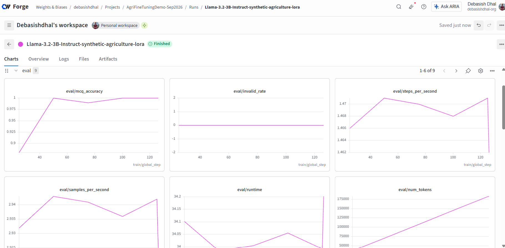
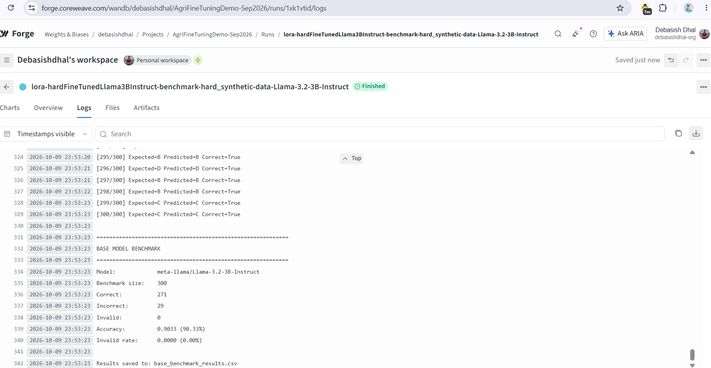
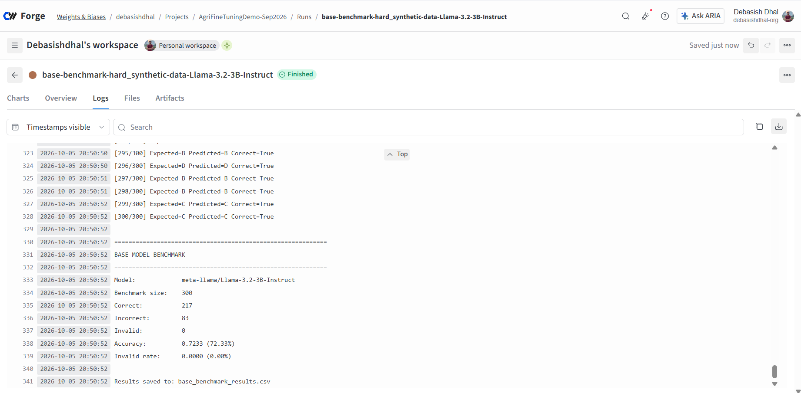
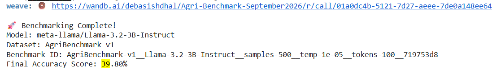
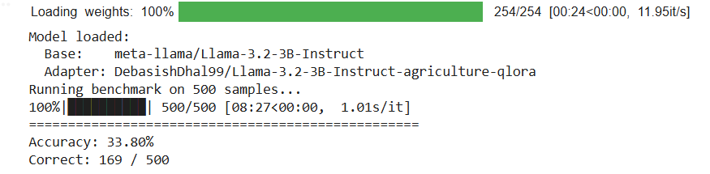
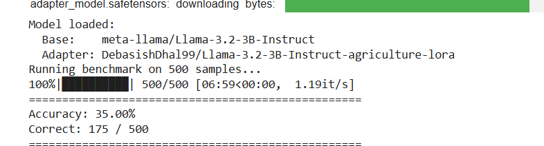

# Fine-tuning Llama 3B model with synthetic agricultural dataset (Primary)
- Loss type: Eval loss
- Base model: [meta-llama/Llama-3.2-3B-Instruct](https://huggingface.co/meta-llama/Llama-3.2-3B-Instruct)
- Training data: [DebasishDhal99/agriculture-synthetic-finetuning-dataset train split](https://huggingface.co/datasets/DebasishDhal99/agriculture-synthetic-finetuning-dataset)
- Benchmark data: [DebasishDhal99/agriculture-synthetic-finetuning-dataset benchmark_hard split](https://huggingface.co/datasets/DebasishDhal99/agriculture-synthetic-finetuning-dataset)
- Training run: https://forge.coreweave.com/wandb/debasishdhal/AgriFineTuningDemo-Sep2026/runs/83hzvezl?nw=nwuserdebasishdhal (Sadly it's not public, I didn't make this run public in the beginning, and I was unable to change the project visibility later. If you need to view the training runs, send me your email, I'll add you manually to the project.)
- Fine-tuned model's Benchmark score: 90% (90% of 300 questions were answered correctly)
- Base model's Benchmark score: 72%
- Improvement of 18% more questions being correctly answered bacause of fine-tuning.
- NOTE: Initially, the `banchmark` split of the afforementioned dataset was used for benchmarking, but even the base model was able to score a full 100% accuracy. So, a harder set of questions were prepared in the `benchmark_hard` split.

Eval loss curve for LORA fine-tuning with synthetic training data

Benchmark scores for LORA fine-tuning with synthetic training data

Benchmark scores for base Llama 3B model with synthetic training data

# Fine-tuning Llama 3B with previously-existing dataset (secondary, discarded)

- Base model: [meta-llama/Llama-3.2-3B-Instruct](https://huggingface.co/meta-llama/Llama-3.2-3B-Instruct)
- Training data: [KisanVaani/agriculture-qa-english-only train split](https://huggingface.co/datasets/KisanVaani/agriculture-qa-english-only)
- Benchmark data: [bharatgenai/BhashaBench-Krishi first 500 rows](https://huggingface.co/datasets/bharatgenai/BhashaBench-Krishi)
- Training run: https://forge.coreweave.com/wandb/debasishdhal/AgriFineTuningDemo-Sep2026/runs/is0hv1hx (For LORA), https://forge.coreweave.com/wandb/debasishdhal/AgriFineTuningDemo-Sep2026/runs/3ueuokh0 (For QLORA) (Ditto, it's not public)
- Fine-tuned model's benchmark score: 32%

- Base model's benchmark score: 39%

- QLORA model's benchmark score: 33% (Quantized LORA)

- LORA model's benchmark score: 35%

- In the second case, clearly QLORA/LORA are not the problem. The problem was that we were fine-tuning the model for task A (free-flow response generation) and benchmarking the model for task B (Choose the correct response). While training for task A, the model's natural ability in task B degraded.
